# ログ探偵

## ステップ１
```bash
cat access.log | wc -l

head -5 access.log
tail -5 access.log
```

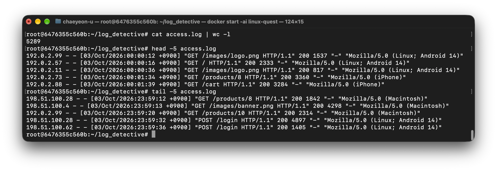

## ステップ２
```bash
awk '$9 == 500 {print $9}' access.log | wc -l
awk '$9 == 500 {print $7}' access.log | uniq

awk '$9 == 500 {print $4}' access.log | sort | head -n -1
awk '$9 == 500 {print $4}' access.log | sort | tail -n -1
```


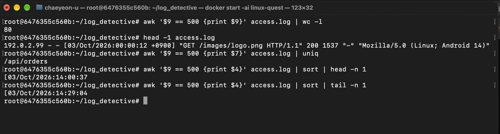

## ステップ３
```bash
awk '{print $1}' access.log | sort | uniq -c | sort -r | head -n 5
awk '$1 == "203.0.113.66" {print $9}' access.log | sort | uniq -c

awk '$1 == "203.0.113.66" {print $4, $7}' access.log | sort | uniq
awk '$1 == "203.0.113.66" {print $4, $7}' access.log | sort | uniq | head -n 1
awk '$1 == "203.0.113.66" {print $4, $7}' access.log | sort | uniq | tail -n 1


awk '$1 == "203.0.113.66" && $9 != 401 {print $0}' access.log
```

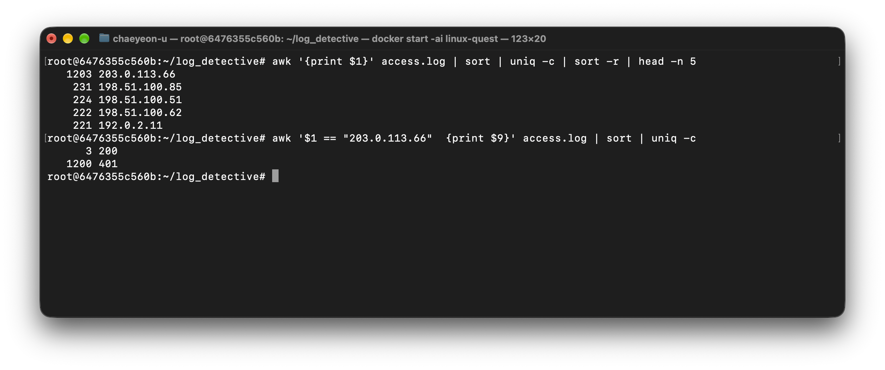
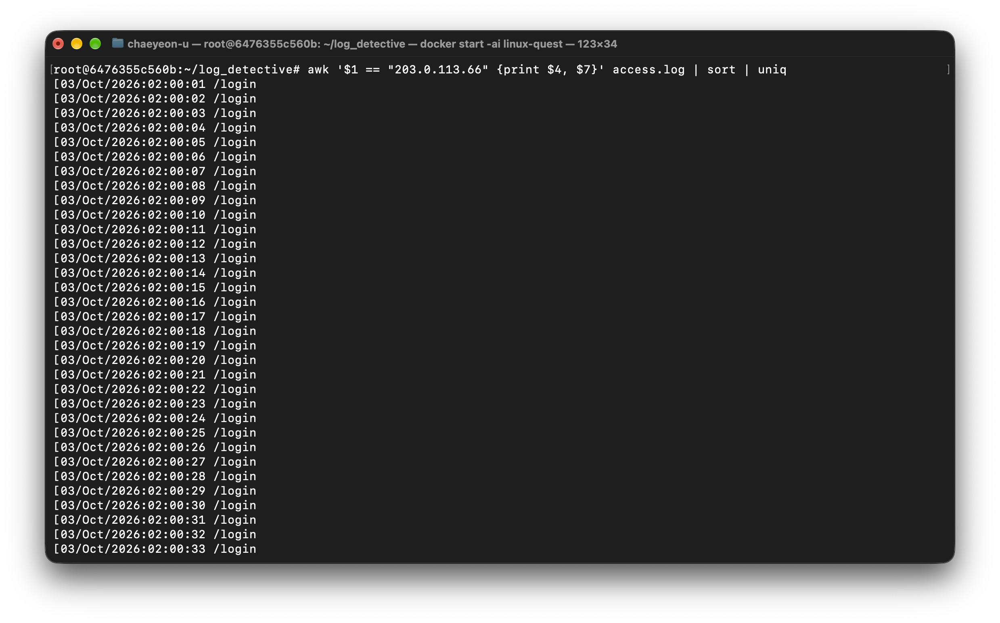
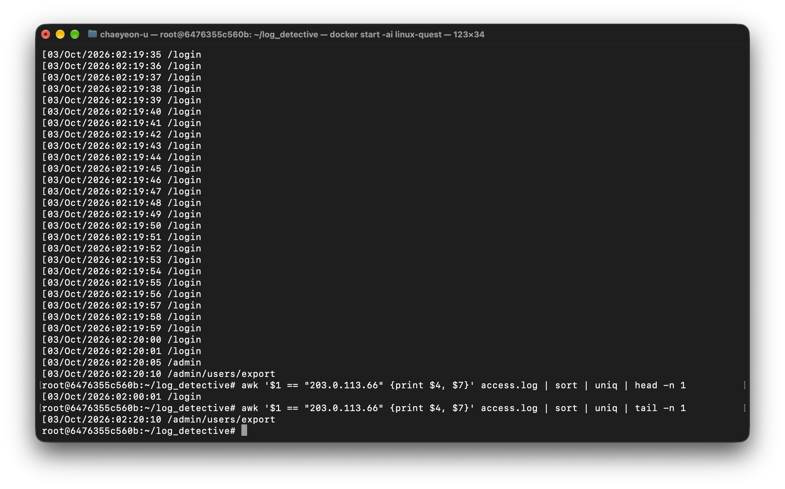
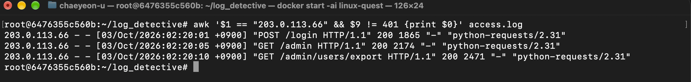

### 質問３−５：この IP アドレスは何をしていたと考えられますか。また、攻撃は成功したと思いますか。理由とともに答えてください
- 管理者にアクセスするとしました。アクセスに成功しましたので、攻撃はで成功です。

## ステップ４
```bash
awk '$9 == 404 {print $7}' access.log | uniq -c

grep "/.git/config" access.log
grep "/backup.zip" access.log
grep "/.env" access.log
```

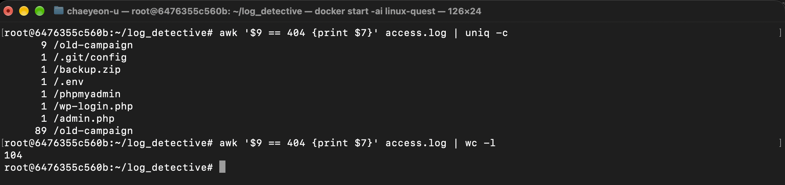
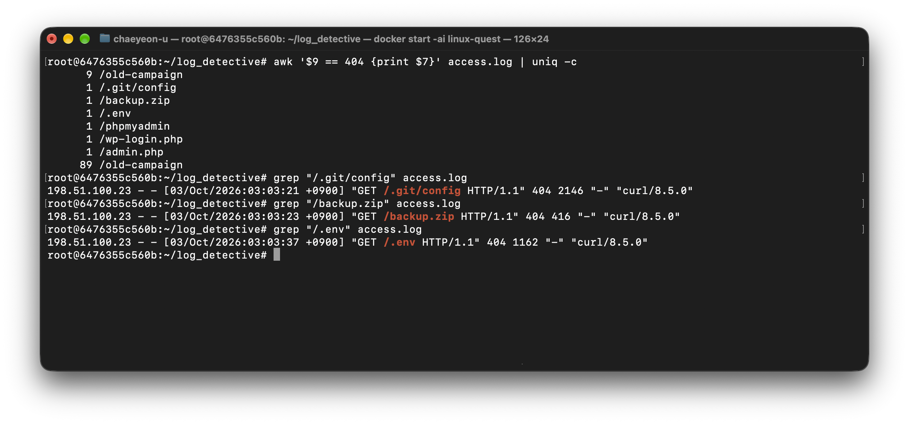

### 質問４−２：怪しいアクセスをしている IP アドレスと、そのユーザーエージェントを答えてください。なぜ怪しいと思ったのかも答えてください
- 怪しいアクセスをしているIPアドレスは"198.51.100.23"で、そのユーザーエージェントは"curl/8.5.0"です。
- gitの設定情報、バックアップファイル、パスワードを保存するパスにアクセスしたかあらです。

## ステップ５
```bash
awk '{print(substr($4, 14, 2))}' access.log | uniq -c
```

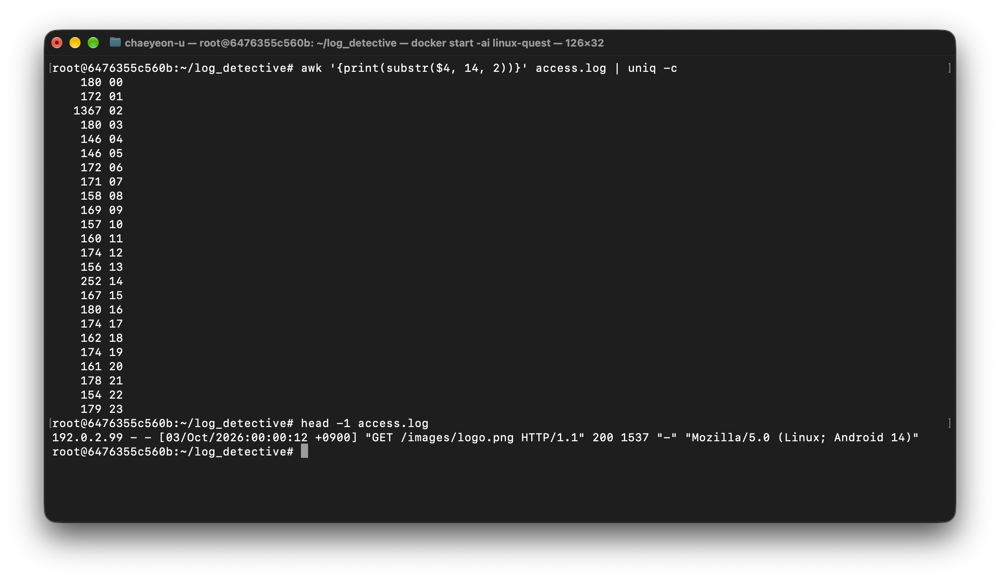

### 質問５−２：一番アクセスが多かったのは何時台ですか。それはなぜだと考えられますか
- 02時です。ユーザーが少ない時間台と思ったからです。

## ステップ７
```bash
ls access.log no_such.log

1s access.1og no_such.1og > ok.txt 2> error.txt

ls access.log no_such.log > all.txt 2>&1

grep -r "TREASURE" /etc
grep -r "TREASURE" /etc 2>/dev/null
```

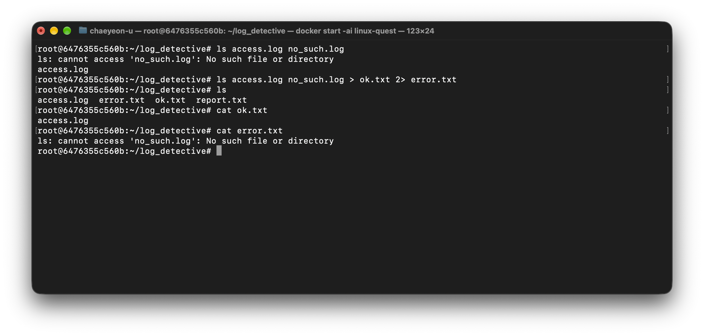
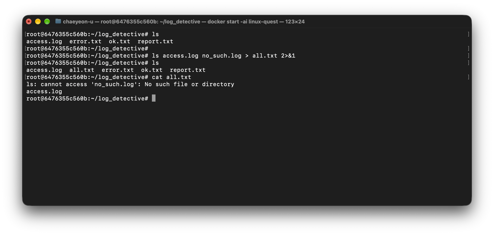
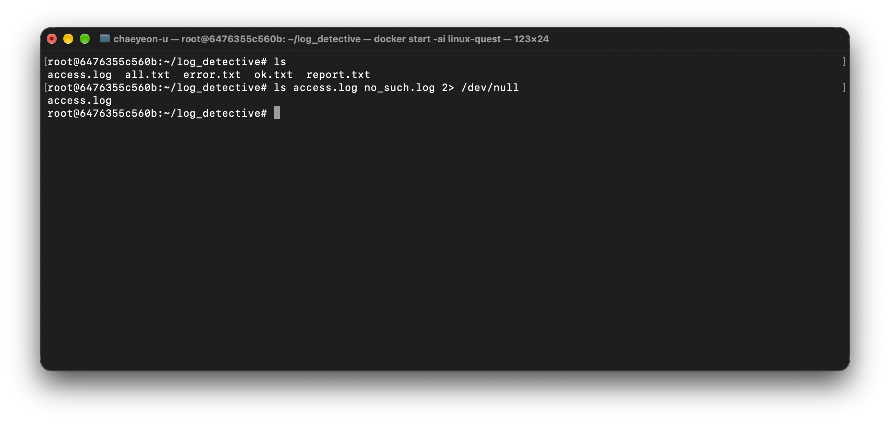
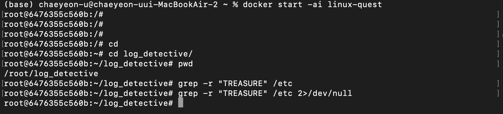

## ステップ８

### 質問８ー１：標準入力、標準出力、標準エラー出力とは何ですか
- 標準入力：プログラムが実行した後、データを入力する通路
- 標準出力：コマンドの正しい実行結果を出力する通路
- 標準エラー出力：プログラム実行中、エラー（例外状況）が発生した時、エラーメッセージを出力する通路

### 質問８−２：リダイレクトの > と >> の違いは何ですか。2> や 2>&1 は何を意味しますか
- ">"：コマンドの出力結果を、指定したファイルに出せます。ファイルがなかったら生成します。ファイルが存在する場合、既存の内容を削除して上書きします。
- “>>”：コマンドの出力結果を、指定したファイルの最後の最終行の下に追加します。ファイルがなかったら生成します。ファイルが存在する場合、既存の内容の下に追加します。
- “2>”：標準エラー（2）をリダイレクトする意味です。
- “2>&1”：標準エラー（2）を標準出力(&1)でリダイレクトする意味です。

### 質問８−３：/dev/null とは何で、どういう時に使われますか
- そのパスに送信される全てのデータを消滅させます。データを削除する時に使います。

### 質問８−４：パイプライン | とは何ですか。パイプラインを使うと何が嬉しいのですか
- 前のコマンドの標準出力を後ろの標準入力に渡す機能です。ファイルから目的のキーワードだけを抽出する時に使います。

### 質問８−５：今回の調査結果を、エンジニアではないカスタマーサポートの人に向けて、3〜5 行程度で報告してください
- ユーザーのアクセスが少ない時間帯の午前2時に、攻撃をもらいました。
外部から管理者ファイルにアクセスを試みして、成功しました。
パスワードが保存しているファイルにアクセスし、情報流出の可能性があります。