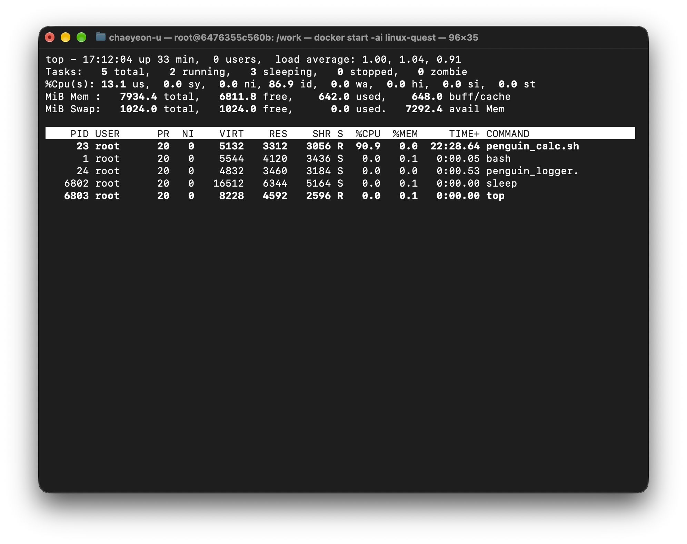
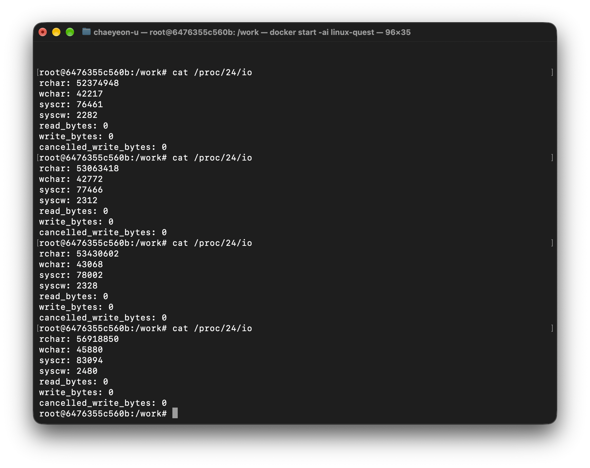
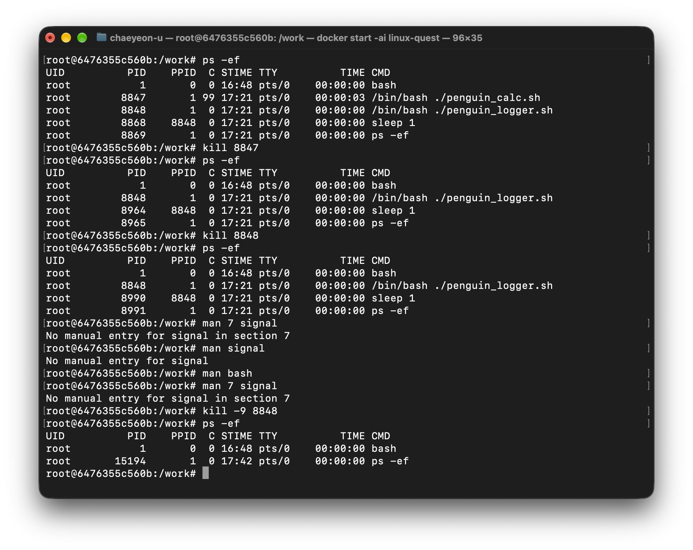
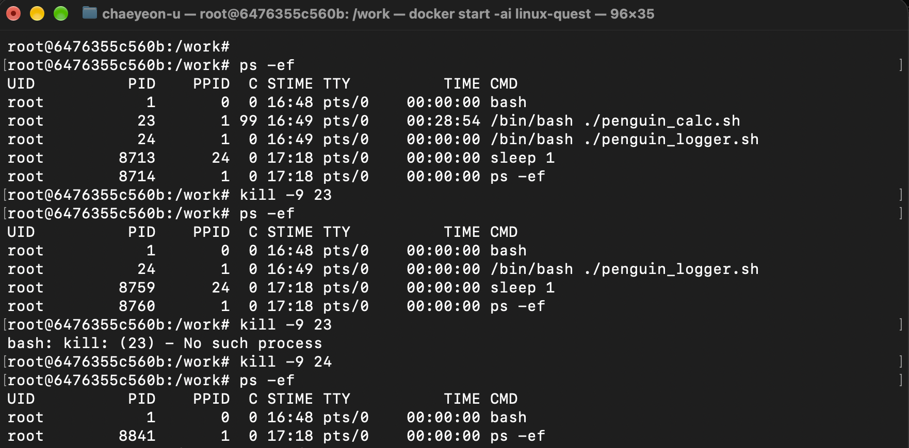
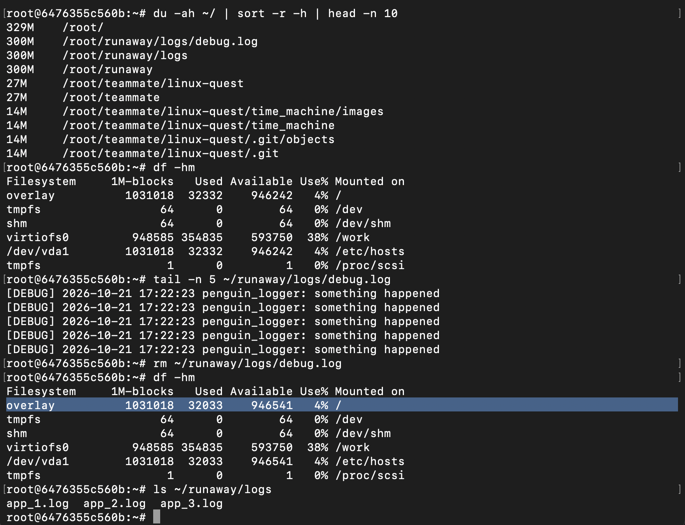
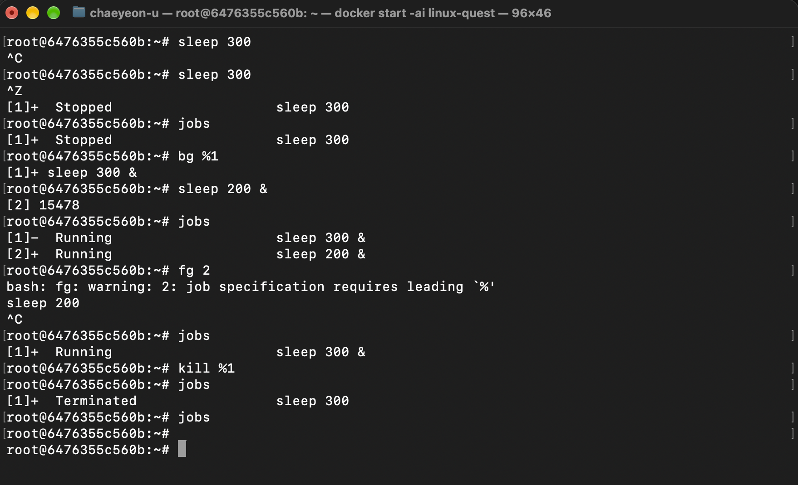

# 暴走プロセスを止めろ
## ステップ１
```bash
top

cat /proc/[PID]/io
```

- PID: 23, CPU使用率: 100% - penguin_calc.sh
- PID: 24, CPU使用率: 0% - penguin_logger.




## ステップ２
```bash
kill [PID]

kill -9 [PID]
```

### 質問２ー１：プロセスを止めるときに使ったコマンドは、プロセスに「シグナル」という合図を送るコマンドです。何も指定しないと、どのシグナルが送られますか
- 何も指定しないと、デフォルトの15(SIGTERM)が送信されます。

### 質問２ー２：片方のプロセスは、止めるのに苦労したはずです。~/runaway にあるスクリプトの中身を読み、なぜ止まりにくかったのかを説明してください
- スクリプトを見ると「trap '' TERM INT HUP」があります。このパートはのせいで、killをしても止めるのできなかったです。
trapは特定シグナルが届いたとき、特定行動をさせます。
TERM, INT, HUPはそれぞれ終了(kill)、ctrl+cでインタラプト、ターミナルの終了です。
この三つのシグナルが届いたとき、trapは''の中を実行します。
''の中には何もありません。
結果的に、killをしても、何も起こらないです。

### 質問２ー３：どんなプロセスでも確実に停止できる方法があるのに、なぜ普段はまず別の方法で止めるべきなのでしょうか
- kill -9をすると強制終了になります。その場合、プロセスがひとりで持っていたリソースがLockの状態で残ります。すると、システム全体的に性能が低下する可能性があります。
kill (-15)をするとプロセスが終了のための時間をもらいます。その場合、正常にメモリ解放が可能です。




## ステップ３
```bash
du -ah ~/ | sort -r -h | head -n 10
df -hm

tail -n 5 ~/runaway/logs/debug.log

rm ~/runaway/logs/debug.log
df -hm
ls ~/runaway/logs
```



## ステップ４
```bash
sleep 300
ctrl+c
sleep 300
ctrl+z
jobs
bg %1
sleep 200 &
jobs
fg 2
jobs
kill %1
jobs
jobs
```
> fg %2をするとき、間違えて’fg 2’でコマンドを使用しました。
> その結果、’bash: fg: warning: 2: job specification requires leading `%’’と言うメッセージがありました。
> でも、動作には問題ありませんでした。



## ステップ５
### 質問５−１：準備のスクリプトの中で、プロセスを起動している行を探し、それぞれの部分が何をしているかを説明してください
> nohup ./penguin_calc.sh > /dev/null 2>&1 &
> nohup ./penguin_logger.sh > /dev/null 2>&1 &
- ./penguin_calc.sh(./penguin_logger.sh)の標準出力を/dev/nullへ送信いて、2>&1を通じて./penguin_calc.sh(./penguin_logger.sh)の標準エラー出力(2)も標準出力(&1)に(結論的には/dev/nullへ、標準出力が/dev/nullへ繋がっているいるかか)送信します。

### 質問５−２：ターミナルを閉じたとき（ログアウトしたとき）、普通にバックグラウンドで実行したジョブはどうなりますか。準備のスクリプトのように起動した場合はどうなりますか
- ターミナルを閉じたとき、終了されます。
- hohupを通じてHUP(hangup)シグナルを無視するようにします。
結論的にはターミナルを閉じてもプログラムは続けて実行します。

## ステップ６
### 質問６ー１：プロセスとは何ですか。プログラムとの違いは何ですか
- プロセスはOSからリソースをもらって実行しているプログラムです。
メモリ上にあるプログラムをプロセスと言います。
プログラムは実行してないファイルです。

### 質問６ー２：ジョブとは何ですか。プロセスとの違いは何ですか
- ジョブはユーザーが使ったコマンドです。
プロセスはLinuxカーネルから見た処理の単位、ジョブはShellからみた処理の単位です。

### 質問６ー３：フォアグラウンドとバックグラウンドの違いは何ですか
- フォアグラウンドはユーザーと相互作用するプロセスです。
画面に出力されて、ユーザーの入力を受けて作業を実行します。
バックグラウンドはユーザーと相互作用しないプロセスです。
画面に出力されず、ユーザーの入力を受けらずに作業を実行します。
一つのターミナルの中で複数のプロセスを実行できます。

### 質問６ー４：今回のように「サーバーの様子がおかしい」と言われたとき、あなたならどんな順番で何を調べますか
- 原因を探すためにCPU、ディスクを圧迫しているプロセスを探します。
topを通じてリアルタイムでCPU使用率の確認、/proc/[PID]/ioを通じてディスクを圧迫しているプロセスを探します。
プロセスを特定し、想定外のプロセスを終了させたいです。
そのあとは、またCPUとディスクの使用率を調査してミスしたものがないか確認します。