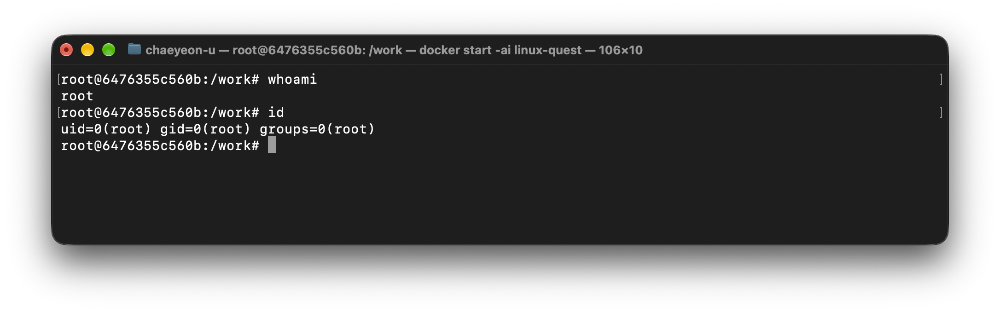
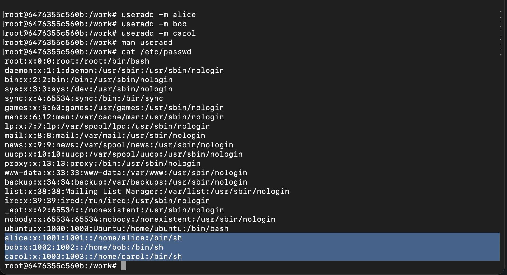
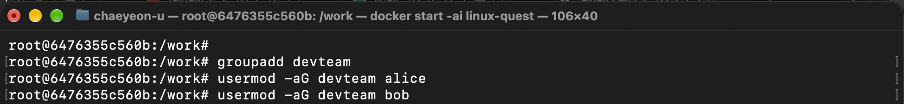
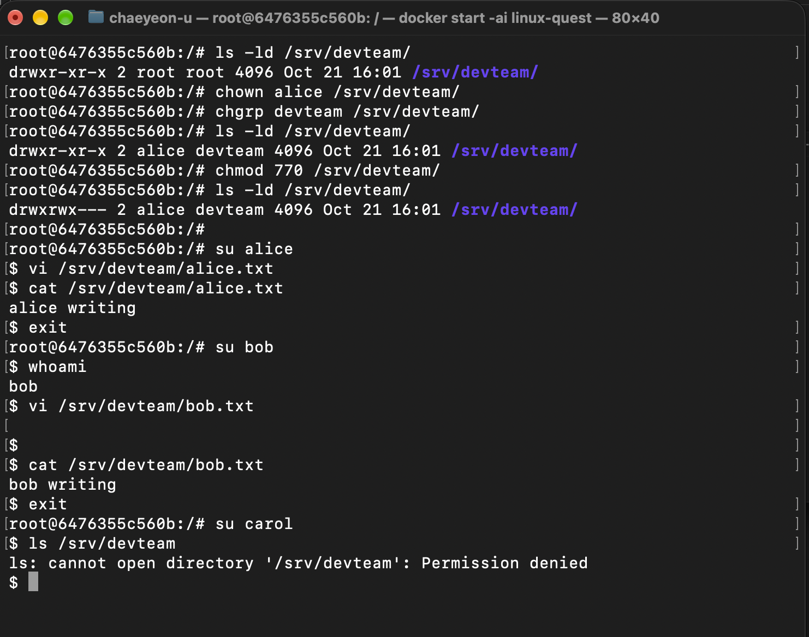
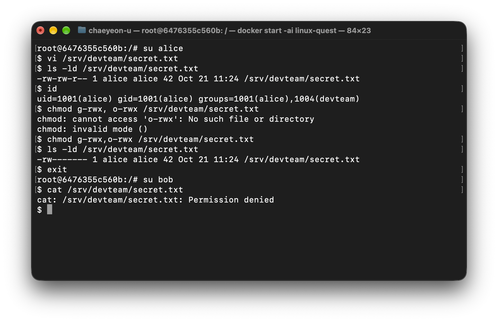
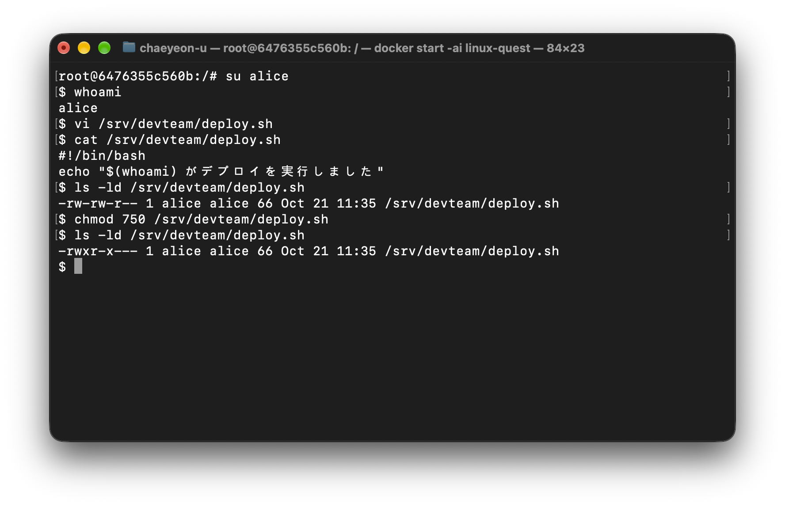
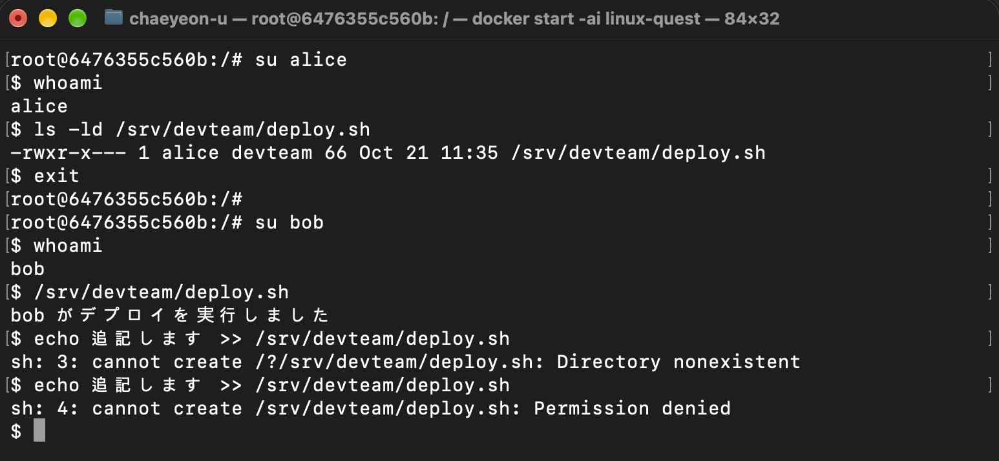
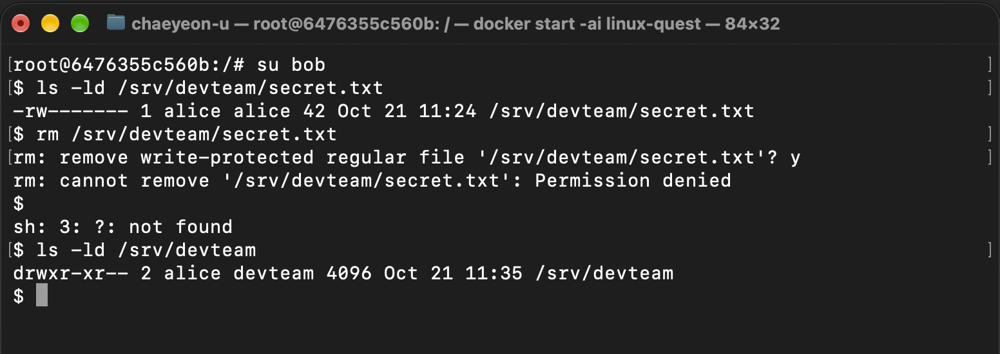
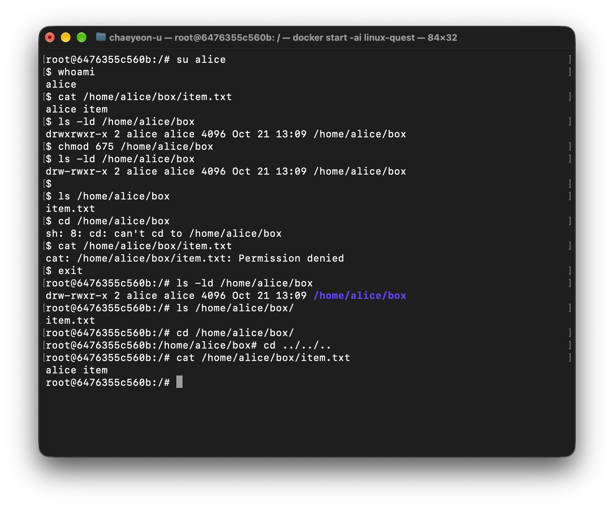
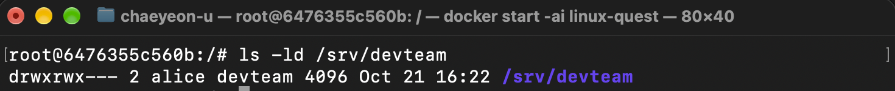

# チームの共有フォルダ

## ステップ１
```bash
whoami

id
```



### 質問１−３：今ログインしているユーザーは、スーパーユーザー（root）ですか。スーパーユーザーとは何かも説明してください
- root です。Linuxシステムの中で最高権限を持っているユーザーです。

## ステップ２
```bash
useradd -m alice
useradd -m bob
useradd -m carol

cat /etc/passwd

groupadd devteam
usermod -aG devteam alice
usermod -aG devteam bob
```




## ステップ３
```bash
chown alice /srv/devteam
chgrp devteam /srv/devteam
chmod 770 /srv/devteam

ls -ld /srv/devteam

su alice
vi /srv/devteam/alice.txt

su bob
vi /srv/devteam/bob.txt

su carol
ls /srv/devteam
```



### 質問２；/srv/devteam のパーミッションを表示し、その表示の 1 文字ずつが何を意味しているかを説明してください。
- drwxrwx---　です。
- dはディレクトリを表示する文字です。
- 最初のrwx：所有者の権限、読み書きと実行ができます。
- 2番目のrwx：グループ所有者の権限、読み書きと実行ができます。
- 最後の---：一般ユーザーの権限、全部不可能です。

## ステップ４
```bash
su alice
vi /srv/devteam/secret.txt
chmod g-rwx,o-rwx /srv/devteam/secret.txt
exit

su bob
cat /srv/devteam/secret.txt
```



## ステップ５
```bash
su alice
vi /srv/devteam/deploy.sh
chmod 750 /srv/devteam/deploy.sh
exit

su bob
/srv/devteam/deploy.sh
```




## ステップ６
```bash
su bob
rm /srv/devteam/secret.txt
```



```bash
su alice
mkdir /home/alice/box
vi /home/alice/box/item.txt

chmod 675 /home/alice/box

ls /home/alice/box
cd /home/alice/box
cat /home/alice/box/item.txt
```



### 質問６ー２：box ディレクトリから 所有者の実行権限（x）だけ を外したとき、alice として ls box、cd box、cat box/item.txt を実行するとそれぞれどうなりますか。ディレクトリにおける r と x の違いを説明してください（root のままで試すと違いを確認できません。それはなぜかも答えてください）
- aliceとして“ls box”, “cd box”, “cat box/item.txt”を実行すると、lsは成功、cdとcatは失敗します。
ディレクトリでrはディレクトリ内のファイルやディレクトリを照会できる権限です。
xは当ディレクトリの中に入ったり、中のファイルに接近ができる権限です。
- rootのままで試すと違いを確認できません。
rootはパーミッションの影響をもらえないからです。

### 質問６−３：「とりあえず chmod 777 しておけば動く」という意見があります。なぜこれが危険なのかを説明してください
- chmod 777おしていると全てのユーザーを許可します。
重要な情報を他のユーザーから見られるし、修正することもできます。

## ステップ７
###　質問７ー１：ファイルの所有者とグループとは何ですか
- 所有者はファイルを直接生成したユーザーです。
グループは特定の権限を公有するユーザーたちです。

###　質問７ー２：パーミッションの r、w、x はそれぞれ何を意味しますか。chmod 640 の 6、4、0 は誰に何の権限を与えることを意味しますか
- rは内容を読むことに対する権限です。
wは内容を変更することに対する権限です。
xはファイルを実行することに対する権限です。
- chmod 640は所有者にrとwを、グループユーザーにrを、一般ユーザーには何の権限も与えないことを意味してます。

###　質問７ー３：sudo とは何ですか。なぜ普段から root で作業しない方がよいのですか
- sudoは一般ユーザーが管理者権限でコマンドを使うときに使用するコマンドです。
rootは全ての作業ができます。rootでは小さな勘違いでもシステム全体に影響を与えることができます。勘違いで重要なファイルを削除する可能性があります。

## 提出物
