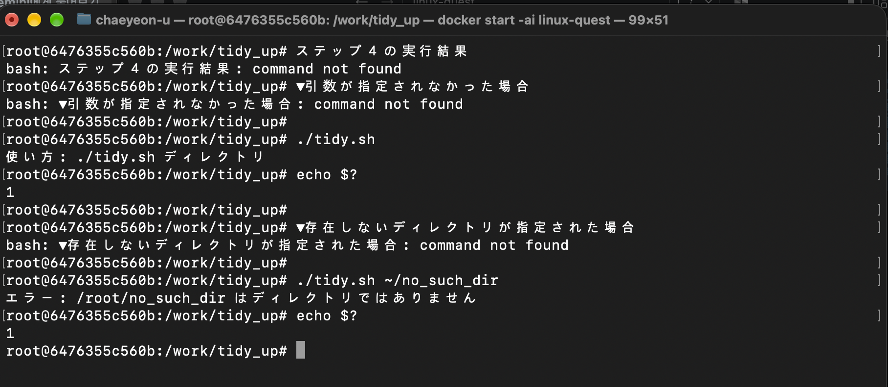
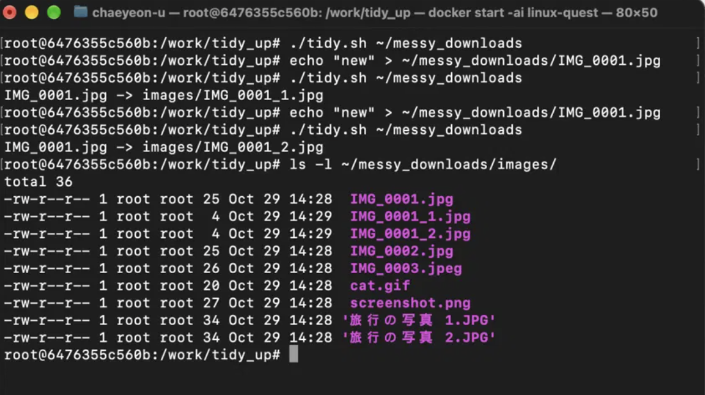
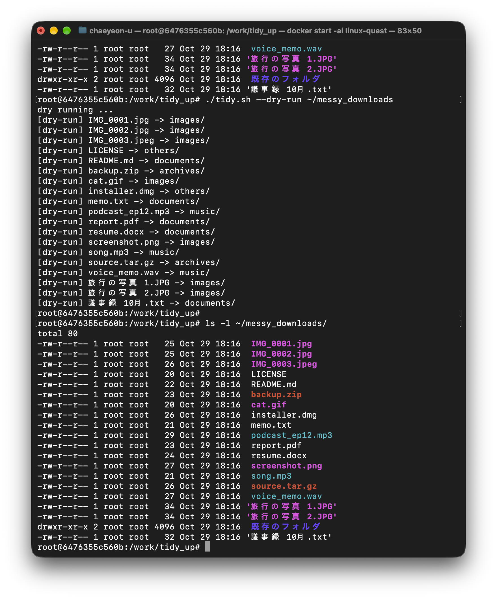
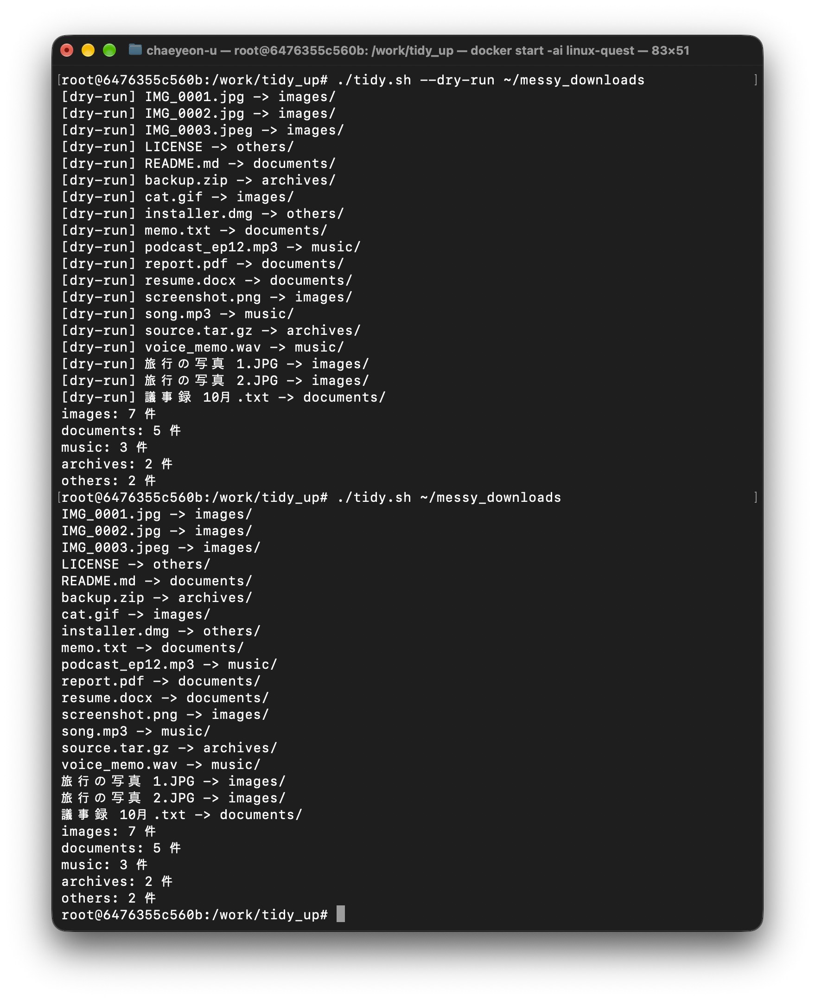
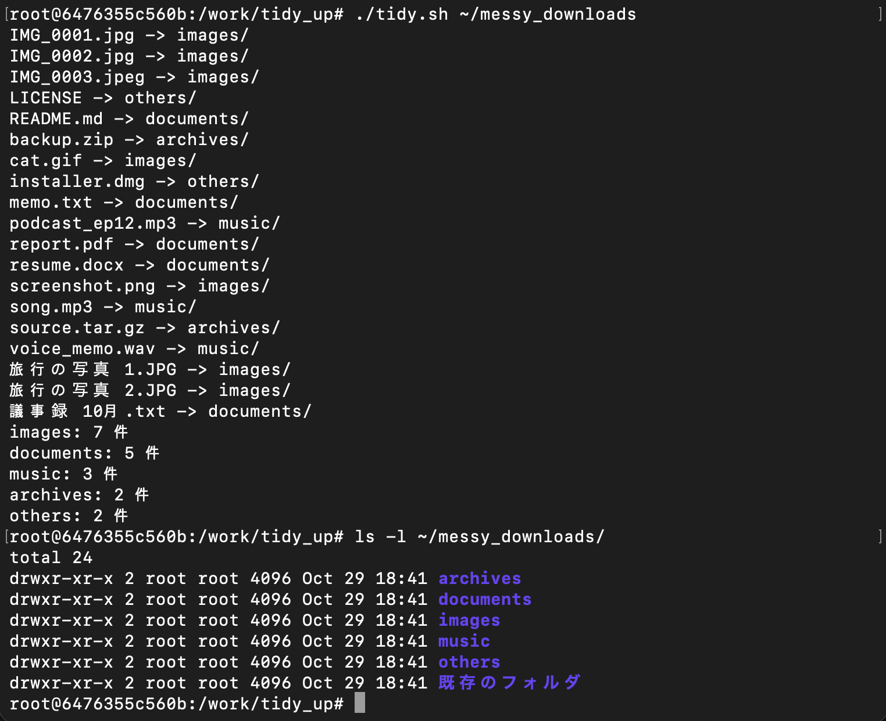
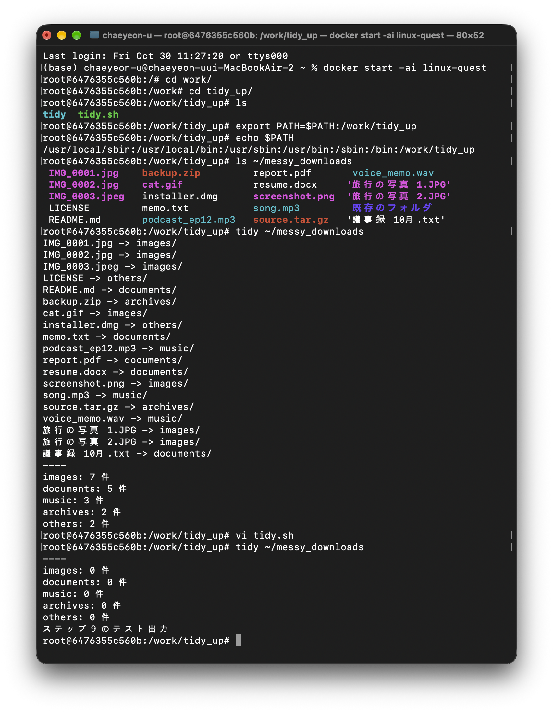
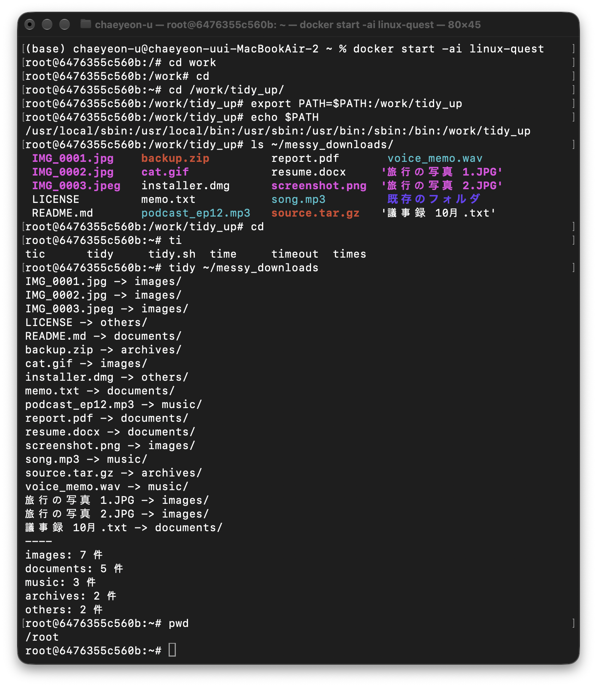
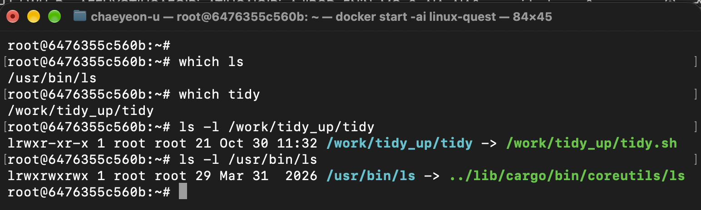
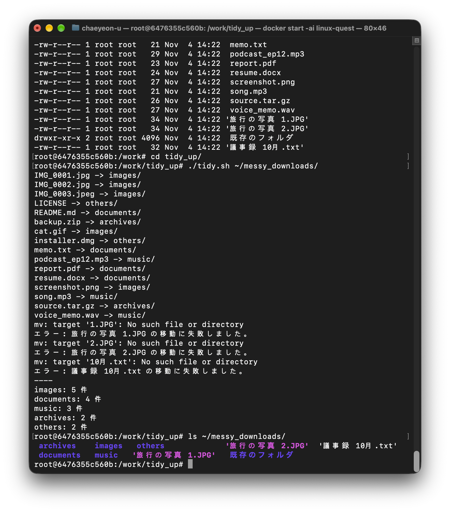
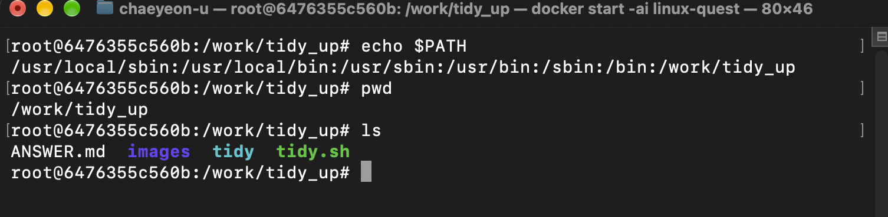

# お片付けスクリプト
## ステップ4の結果


## ステップ5の結果


## ステップ6の結果


## ステップ7の結果



## ステップ8の結果




## ステップ10の回答
### 質問１：シェルスクリプトの 1 行目に書く #!/bin/bash は何のためにありますか
- #!はshebangです。#!の次に「このスクリプトファイルを実行するとき、とんなインタプリタ(Interpreter)を使うか」をカーネルに教える役をします。
#!/bin/bashは、システムに「スクリプトを実行するとき、/bin/bashインタプリタを使って」の意味です。

### 質問２：スクリプトに渡された引数と、その数は、どのようにして取得しましたか
- 引数と、その数は、`$#`と`"$@"`を通じて取得しました。

### 質問３：ファイル名にスペースが含まれるファイルを正しく扱うために、どのような工夫をしましたか。工夫しないとどんな問題が起きましたか
- 「旅行の写真 1.JPG」のようにスペースが含まれたら、ファイル名を出力したとき「旅行の写真」と「1.JPG」になりました。ファイル名を一挙に扱うのが難しかったです。
messy_downloads中のファイル名を取得するとき、`*`を通じてファイル名を一つずつ取得しました。
また、取得したファイル名がスペースのせいで分かれないように`" "`を使いました。
`mv $a $findes`のように`" "`を使わなかったら、`mv`が合計4つの引数を認識して`mv`が失敗します。
結果的には`mv /root/messy_downloads/旅行の写真 1.JPG /root/messy_downloads/images/旅行の写真 1.JPG`になって、以下のスクショのようなエラーが発生します。
tidy.shでは`for a in "$argu"/*; do`、`mv "$a" "$findes"`です。



### 質問４：終了ステータスとは何ですか。なぜエラーのときに 0 以外の値で終了すべきなのですか
- 終了ステータスはプロセスが終了するとき、その作業が正常に完了したのかを親プロセスやシェルに伝えるために返される0から255までの整数です。
ステータスが０の場合は正常に完了したことを意味します。
エラーのときは0以外の値で終了する必要があります。

### 質問５：ステップ8は、どのような仕組みで実現しましたか。環境変数 PATH という言葉を使って説明してください
- まず、`ln -s /work/tidy_up/tidy.sh /work/tidy_up/tidy`シンボリックリンクを生成しました。
`tidy`だけで実行できるためです。
次は、環境変数PATHに`/work/tidy_up`を追加しました。この結果、どのディレクトリにいても`tidy`だけで実行ができました。
- PATHはシェルが実行ファイルを実行するとき、そのファイルがどこにあるかを教えます。
tidyってうたれたとき、PATHのディレクトリを探します。`ディレクトリ/tidy`を見つけたら実行します。
```bash
/usr/local/sbin:/usr/local/bin:/usr/sbin:/usr/bin:/sbin:/bin:/work/tidy_up
```
```bash
/usr/local/sbin/tidy
/usr/local/bin/tidy
/usr/sbin/tidy
/usr/bin/tidy
/sbin/tidy
/bin/tidy
/work/tidy_up/tidy # tidyがある。
```



- PATHはターミナルが閉じる前まで有効です。
ターミナルが閉じたらシンボリックリンクは残りますが、PATHにあったパス(`/work/tidy_up`)が消えます。
結果的にはシンボリックリンクを使えません。
```bash
echo 'export PATH="$PATH:/work/tidy_up"' >> ~/.bashrc
```
- 上記のコマンドでターミナルを再起動しても、シンボリックリンクが残るようにすることができます。