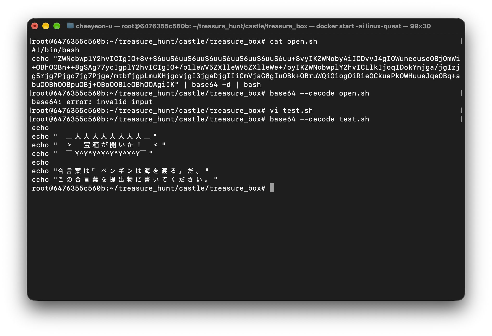
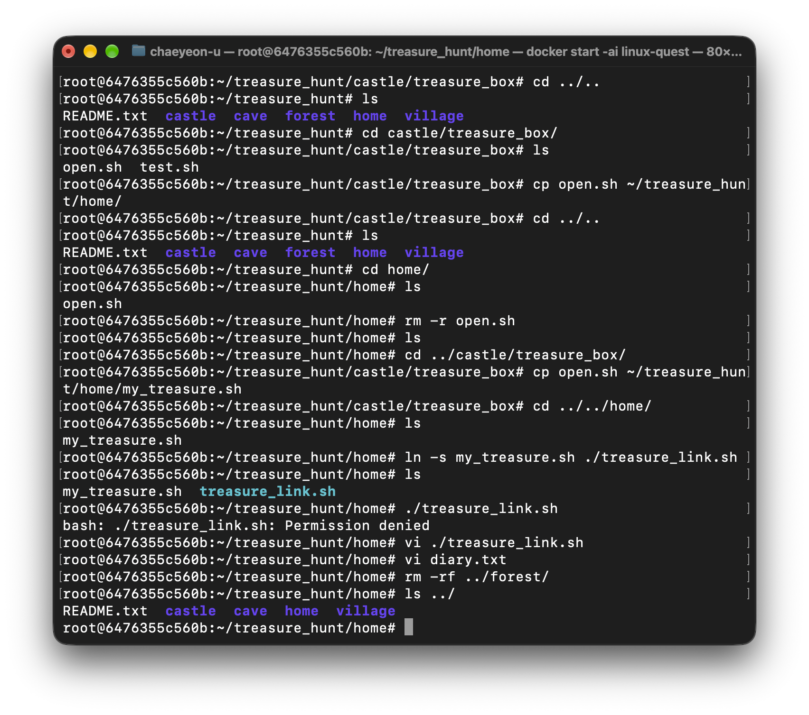
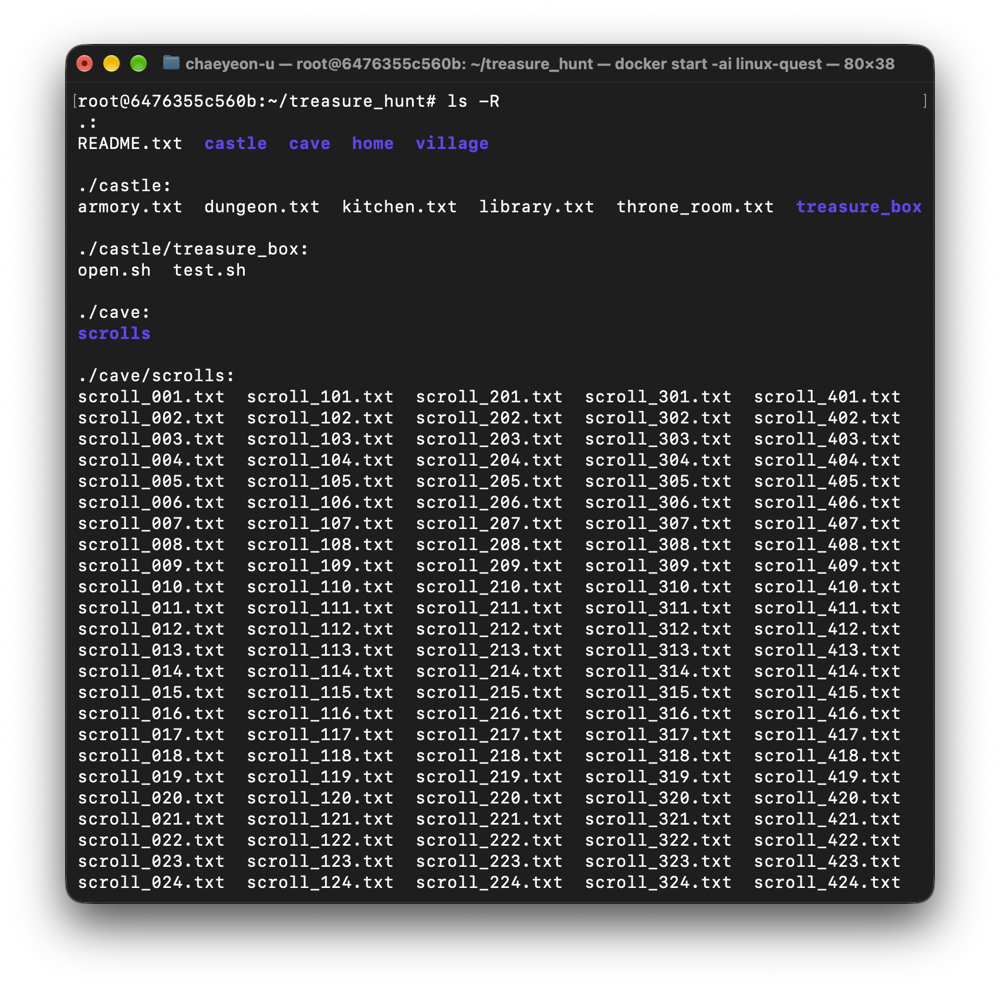
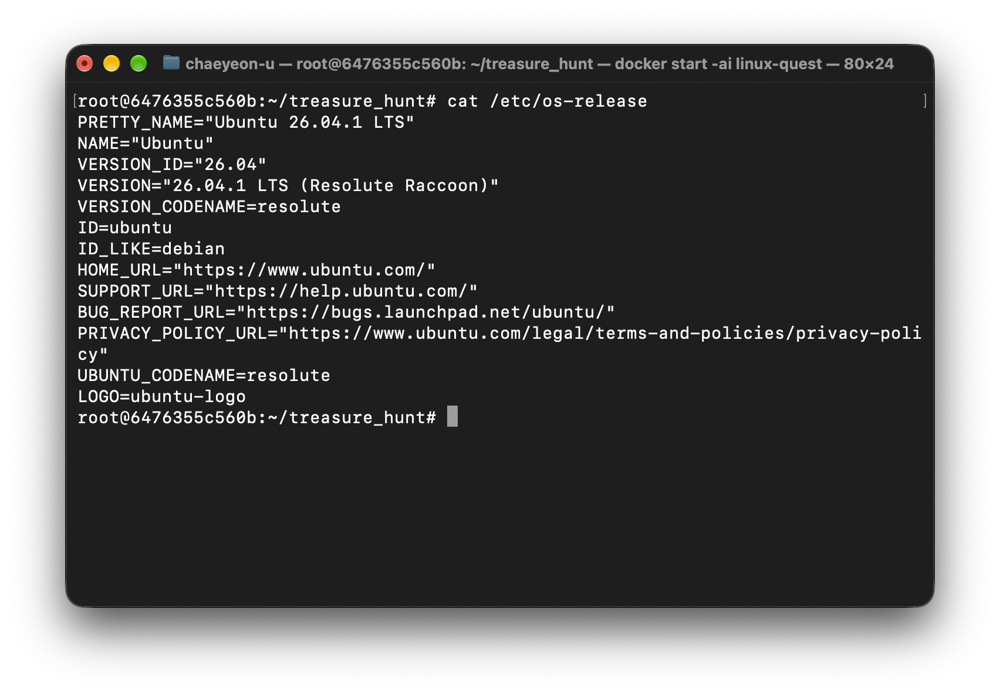
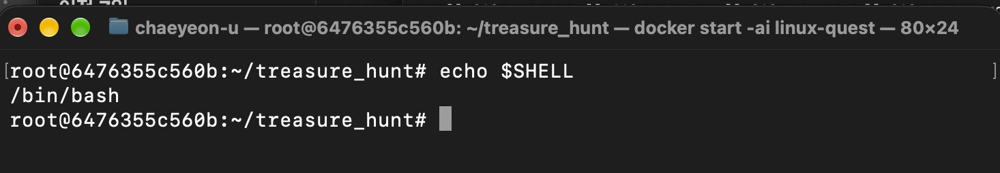

# 宝探し

## ステップ１
```bash
ls -al

find ./ -name "map.txt"

find ./ -name "*.txt" \ xargs grep "TREASURE"

# サイズが大きいファイルを探す。
ls -l

sed -n '2345p' library.txt

# open.shから" "の中にある文字をコピーしてtest.shファイルを作りました。
base64 --decode test.sh
```


> 合言葉は「ペンギンは海を渡る」です。

## ステップ２
```bash
cp open.sh ~/treasure_hunt/home/my_treasure.sh

ln -s my_treasure.sh ./treasure_link.sh

# treasure_hunt/homeディレクトリで実行しました。
rm -rf ../forest/

ls -R
```




## ステップ３
### 質問１：OS とは何ですか。また Linux とは何ですか
- OSはハードウェアとアフリケーション間の相互作用を管理、制御するソフトウェアです。

### 質問２：Linux におけるカーネルとディストリビューションとは何ですか。あなたが今使っている Linux のディストリビューションは何ですか（調べ方もあわせて答えてください）
- カーネルはハードウェアとソフトウェアを繋ぐ役割をします。またハードウェアのリソースを管理する役割をします。
- ユーザーが直接使用することは難しいです。
- 今使っているLinuxのディストリビューションは以下のコマンドで確認ができます。
Ubuntuを使っています。
> cat /etc/os-release
---


### 質問３：シェルとは何ですか。あなたが今使っているシェルは何ですか
- シェルはカーネルとユーザーを繋げるインタフェース役のプログラムです。
- 以下のコマンドで確認ができます。
bashを使っています。
> echo $SHELL
---


### 質問４：絶対パスと相対パスの違いは何ですか。~、.、.. はそれぞれ何を表しますか
- 絶対パスと相対パスはファイルやディレクトリを表示する方法について差があります。
- 絶対パスは最上位ディレクトリから目標ファイルまでの経路をスタートから終わりまで表示します。
- 相対パスは現在位置を基準に目標ファイルまでのパスを表示します。」

- ~ ： homeディレクトリを表示します。
- . ：　現在ディレクトリ
- .. : 上位ディレクトリ

### 質問５：今回の宝探しで、ファイルを探すために使った 2 つのコマンドは、それぞれどのような場面で使うものですか
- ls　：現在位置しているファイルやディレクトリを確認するために使います。
- find　：条件に合うファイルやディレクトリを探すために使う。